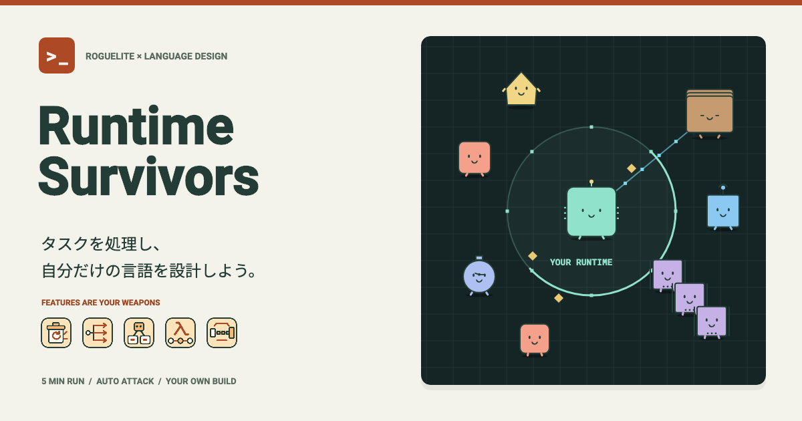

# Runtime Survivors

[](https://okaryo.github.io/runtime-survivors/)

プログラミング言語を育て、押し寄せるタスクを処理するローグライト・アクションゲーム。

プレイヤーは、生まれたばかりのプログラミング言語です。レベルアップごとに言語機能や基盤強化を選択し、自分だけの戦い方を作ります。コードを書くゲームではなく、言語そのものを設計するゲームです。

- 移動と自動攻撃で5分間生存。編成が変わる6回のラッシュと、残り1分・30秒の負荷上昇に対応する
- 10種類のFeature・7種類の共通基盤強化から、それぞれ最大4種類を選ぶ。Featureは最大4ランク、基盤強化は最大6ランク
- ランダムな3択で、攻撃方法とトレードオフを組み合わせる
- 範囲回収のGC、独立攻撃のOOP、撃破で伸びるJITゲージ、複数接続のストリーム、持続領域を残す遅延評価などを使い分ける
- 再送するRPC、二つの隙間を持つタイマーパルス、メモリリーク、前方に障壁を展開するデッドロックなど9種類のタスクに対応する
- 終了時に「Javaっぽい言語」など、取得したFeatureに応じたプロフィールを確認する
- 遭遇した敵と取得した能力を「ランタイム図鑑」に記録する
- 日本語・英語、戦闘BGM・効果音・クリア音、音量設定に対応。設定と発見記録はブラウザに保存する

Flutter + Flameで開発しているPCブラウザ向けゲームです。キーボード操作を前提とし、1280×640以上の表示領域を目安にしています。

## 操作

| 操作 | キー |
| --- | --- |
| ランタイム開始 | Enter |
| 移動 | WASD / HJKL / 矢印キー |
| 能力の取得 | 1 / 2 / 3、またはTabで移動してEnter |
| 一時停止・再開 | Esc / P |

攻撃は自動です。敵を倒すと落ちる ◆ を集めてレベルアップし、メモリが尽きる前に5分間生き残ればクリアです。能力カードはクリックでも選択できます。

能力選択中は時間と戦闘が止まり、メモリと現在のビルドを見ながら選べます。矢印キーを押したまま選択に入っても、ページのスクロールには使いません。別のウィンドウへ移ると自動停止し、再開にはEsc / Pなどの操作が必要です。

ブラウザ版：[Runtime Survivors](https://okaryo.github.io/runtime-survivors/)

現在はゲーム性を検証するプロトタイプです。ラン途中の保存・ビルド共有は未対応です。

## ローカルで遊ぶ

Flutter **3.47.8** / Dart **3.13.7** を使用します。Flutterのバージョン指定は `pubspec.yaml` の `environment.flutter` にあります。

```sh
flutter pub get --enforce-lockfile
flutter run -d chrome
```

Chromeを自動起動せず、任意のPCブラウザで開く場合：

```sh
flutter run -d web-server --web-port 8080
```

表示されたURLを開き、「ランタイムを起動」を選択します。

## 開発

```sh
dart format --output=none --set-exit-if-changed lib test tool
flutter analyze
flutter test
flutter build web --release --no-web-resources-cdn
```

Webビルドの出力先は `build/web` です。GitHub ActionsではPRと `main` の更新時に検証し、`main` の検証成功後にGitHub Pagesへ公開します。

## ドキュメント

- [ゲーム仕様](docs/gameplay.md)：能力、敵、成長、設定・図鑑のルール
- [開発ガイド](docs/development.md)：コード構成、アセット生成、CI、GitHub Pagesの設定
